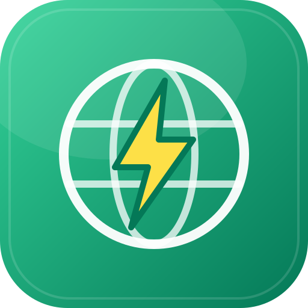

<p align="center">
  
</p>

<h1 align="center">Speednet</h1>

<p align="center">
  Medidor de calidad de conexión para Android: latencia, jitter, pérdida de paquetes,
  velocidad de descarga/subida y señal de red.
</p>

<p align="center">
  <b>Android 12+</b> · Kotlin · Jetpack Compose · Material 3
</p>

---

## Características

- **Latencia, jitter y pérdida** con estrategia en cascada: ICMP → UDP/DNS → TCP.
- **Pérdida bajo carga**: sondas durante la descarga/subida y retransmisiones TCP reales.
- **Velocidad de descarga y subida** contra Cloudflare, con varias conexiones en paralelo.
- **Tipo de red y señal**: Wi-Fi (RSSI/SSID) y celular 4G/5G (RSRP).
- **Puntaje de 0 a 100** ponderado, nivel de calidad y veredictos por uso.
- **Historial persistente** con Room, fecha, lugar y confirmación antes de borrar.
- **Material 3** con modo oscuro e icono adaptativo.
- Aviso de consumo de datos, cancelación en cualquier momento y manejo de sin conexión/permisos.

## Cómo mide

### Latencia, jitter y pérdida

Un `connect()` TCP exitoso **no** implica 0 % de pérdida: si se pierde el SYN, el
kernel lo retransmite y la conexión igual funciona. Por eso la medición intenta,
en este orden:

1. **ICMP** con el binario del sistema (`/system/bin/ping`). No requiere root, pero
   Android 12+ suele restringirlo.
2. **UDP/DNS** a `1.1.1.1:53` y `8.8.8.8:53`. Una consulta mínima sin retransmisión:
   un timeout es una pérdida real y no necesita root.
3. **TCP** como último recurso, clasificando los RTT inflados por retransmisión del SYN.

Además:

- **Jitter** = media de `|RTT_i − RTT_i-1|` entre muestras exitosas.
- **Pérdida** combina las sondas en reposo, las sondas **bajo carga** (mientras se
  mide la velocidad) y la tasa de **retransmisión TCP** (`RetransSegs / OutSegs` de
  `/proc/net/snmp`). Se queda con el peor valor observado: un 0 % en reposo no debe
  ocultar pérdidas que solo aparecen al saturar el enlace.

### Velocidad

- Endpoints de Cloudflare: `__down` y `__up`.
- **6 conexiones** en paralelo para descarga y **4** para subida, sobre HTTP/1.1.
- Se cuentan los bytes **mientras se transfieren** (no al terminar la petición), así
  un timeout en red móvil no deja la métrica en 0.
- `Mbps = bytes × 8 / segundos / 1.000.000`.
- Tope de datos: **~40 MB de bajada + 20 MB de subida** por prueba.

### Señal y red

- `ConnectivityManager` / `NetworkCapabilities` para el tipo de red.
- `WifiManager` para RSSI y SSID (requiere ubicación activada).
- `TelephonyManager` / `CellInfo` para 4G (RSRP) y 5G (SS-RSRP).
- `FusedLocationProvider` para guardar el lugar de la medición.

## Calificación

Puntaje ponderado de 0 a 100:

| Métrica | Peso |
|---|---|
| Descarga | 30 % |
| Latencia | 25 % |
| Subida | 15 % |
| Jitter | 15 % |
| Pérdida | 15 % |

| Puntaje | Nivel |
|---|---|
| 80–100 | Excelente |
| 60–79 | Buena |
| 40–59 | Regular |
| 0–39 | Mala |

**Veredictos por uso** (Óptima / Aceptable / No recomendada):

| Uso | Óptima | Aceptable |
|---|---|---|
| Videollamadas | subida ≥ 5 y bajada ≥ 5, latencia < 50 ms, jitter < 20 ms, pérdida < 1 % | subida ≥ 1.5 y bajada ≥ 1.5, latencia < 100 ms, pérdida < 3 % |
| Streaming | bajada ≥ 25 Mbps (4K) | bajada ≥ 5 Mbps (HD) |
| Juegos | latencia < 30 ms, jitter < 10 ms, pérdida < 0.5 % | latencia < 60 ms, jitter < 20 ms, pérdida < 1 % |
| Navegación | bajada ≥ 5 Mbps, latencia < 100 ms | bajada ≥ 1 Mbps, latencia < 200 ms |

## Pantallas

- **Inicio**: anillo animado con el último puntaje, botón "Medir ahora", progreso
  por etapa y cancelación. Aviso de consumo de datos antes de empezar.
- **Resultados**: puntaje y nivel, tarjetas por métrica, tarjeta de red/señal,
  veredictos por uso, fecha y ubicación.
- **Historial**: mediciones guardadas en Room, con puntaje, fecha y detalle.

## Arquitectura

MVVM + `StateFlow` + Navigation Compose, con tres capas e inyección de dependencias
manual (`AppContainer`).

```text
com.angel.speednet
├── data/
│   ├── local/        Room: entidad, DAO, base de datos y mapeadores
│   ├── network/      Cloudflare, ping TCP/ICMP/UDP y retransmisiones
│   └── repository/   Implementaciones de repositorios
├── domain/
│   ├── engine/       Motor de medición y cálculo de pérdida
│   ├── model/        Measurement, NetworkSignal, TestStage, ...
│   ├── repository/   Interfaces
│   └── scoring/      Puntaje, niveles y veredictos
├── ui/
│   ├── home/         Inicio + ViewModel
│   ├── results/      Resultados + ViewModel
│   ├── history/      Historial + ViewModel
│   ├── components/   ScoreRing, MetricCard, VerdictCard, LevelBadge
│   ├── navigation/   Rutas y NavHost
│   └── theme/        Material 3
├── di/               AppContainer
├── MainActivity.kt
└── SpeednetApplication.kt
```

## Stack

| Componente | Versión |
|---|---|
| Kotlin | 2.2.10 |
| AGP / Gradle | 9.5.2 / 9.6.0 |
| Jetpack Compose (BOM) | 2026.02.01 |
| Material 3 | Compose BOM |
| Navigation Compose | 2.10.2 |
| Lifecycle / ViewModel | 2.11.0 |
| Room (KSP) | 2.8.5 |
| Coroutines | 1.10.2 |
| OkHttp | 4.12.0 |
| Play Services Location | 21.4.0 |

## Requisitos

- Android **12+** (`minSdk 31`, `targetSdk 37`).
- Android Studio reciente o Gradle 9.6 con un **JDK completo** (17+; se usa `jlink`
  en la compilación).
- Android SDK 37.

## Compilar y ejecutar

```bash
./gradlew assembleDebug      # genera app/build/outputs/apk/debug/app-debug.apk
./gradlew installDebug       # instala en el dispositivo/emulador conectado
./gradlew testDebugUnitTest  # tests unitarios
./gradlew lintDebug          # análisis estático
```

> El proyecto usa KSP con el Kotlin integrado de AGP 9. Por eso
> `gradle.properties` incluye `android.disallowKotlinSourceSets=false`.

## Permisos

| Permiso | Uso |
|---|---|
| `INTERNET` | Mediciones HTTP y sondas |
| `ACCESS_NETWORK_STATE` | Tipo y estado de la red |
| `ACCESS_WIFI_STATE` | RSSI de Wi-Fi |
| `ACCESS_COARSE_LOCATION` / `ACCESS_FINE_LOCATION` | SSID, señal y lugar |
| `READ_PHONE_STATE` | Detalle de red celular (opcional) |

Si se deniegan los permisos de ubicación/telefonía, la prueba continúa en modo
degradado (sin SSID ni detalle de señal).

## Consumo de datos

Antes de medir se muestra un aviso. La prueba está limitada a unos **60 MB**
(40 MB de descarga + 20 MB de subida), aunque en redes lentas consume menos.

## Tests

```bash
./gradlew testDebugUnitTest
```

Cubren:

- Cálculo de puntaje, niveles y veredictos (`ScoreCalculatorTest`).
- Mapeo Room ↔ dominio (`MappersTest`).
- Parser de salida de `ping` (`PingOutputParserTest`).
- Sonda UDP/DNS (`UdpPingerTest`).
- Muestreo de retransmisiones TCP (`TcpRetransmissionSamplerTest`).
- Matemática de pérdida/jitter/latencia (`PacketLossMathTest`).

## Icono

El icono de la app se basa en [`app-icons/04-globe-bolt.svg`](app-icons/04-globe-bolt.svg)
y está convertido a icono adaptativo:

- `app/src/main/res/drawable/ic_launcher_background.xml` (degradado).
- `app/src/main/res/drawable/ic_launcher_foreground.xml` (globo + rayo).
- `app/src/main/res/mipmap-anydpi/ic_launcher.xml` y `ic_launcher_round.xml`.

En `app-icons/` hay además otras tres propuestas SVG.

## Limitaciones

- ICMP suele estar restringido en Android 12+; por eso existen los planes B (UDP/DNS)
  y C (TCP).
- Leer SSID/RSSI requiere ubicación activada y permiso concedido.
- `/proc/net/snmp` puede no ser legible en algunas versiones de Android; en ese caso
  la pérdida se estima solo con las sondas.
- Los endpoints `__down`/`__up` de Cloudflare no son una API oficial; si cambian,
  el cliente está centralizado en `CloudflareClient` para sustituirlos.
- No sustituye a una medición certificada (FCC, Ookla, etc.).
